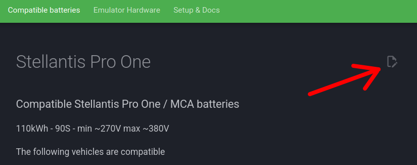
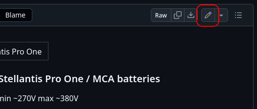
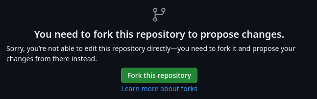
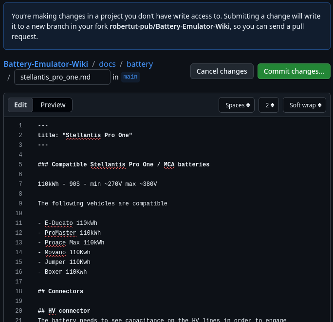
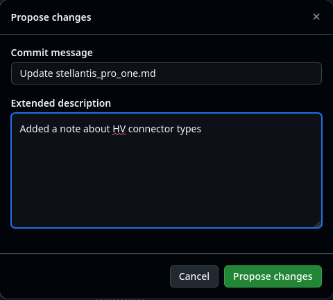
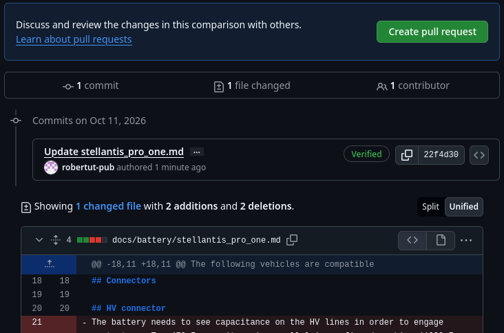
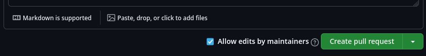
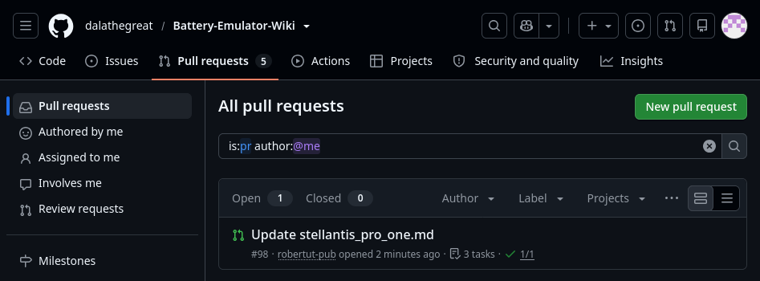
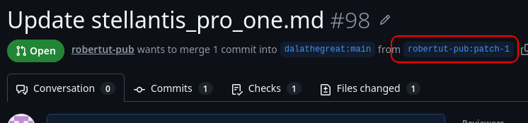

This documentation is written and maintained by the Battery Emulator community. If you spot a mistake, find something outdated, or know a detail that is missing, you can fix it yourself, right in your browser. No software to install and no git knowledge needed.

!!! info "What you need"
    A free [GitHub account](https://github.com/signup). Sign in to GitHub before you start.

## Step 1: Click "Edit this page"

Every page on this site has an **Edit this page** button: the pencil icon in the top right corner, next to the page title. Go to the page you want to improve and click it.

This takes you to the source file of that page on GitHub.

## Step 2: Open the editor

GitHub shows the source of the page. Click the pencil icon (**Edit this file**) above the file contents.

## Step 3: Fork the repository

Since you don't have write access to the documentation repository, GitHub asks you to make your own copy of it first (a *fork*). Click **Fork this repository** button:

Your changes will be saved in your fork, and from there you ask the project team to take them over. **This is needed only the first time**: next time GitHub reuses your existing fork.

## Step 4: Make your changes

The editor opens with the text of the page in Markdown format. Make the changes needed, and use the **Preview** tab for a partial syntax check.

!!! note
    GitHub's preview is close to, but not the same as, this site. Boxes like this one, image sizes and icons only show up correctly once the site is built. When unsure, look at how other pages do it and keep the existing formatting.

Keep a change focused on one topic. A few small, separate changes are easier to review than one big one.

!!! tip
    Need to add a new picture? Just paste the image anywhere you'd like to have it displayed in the page!

## Step 5: Commit (save) your changes

Click the green **Commit changes...** button at the top right when you're done. In the dialog, write a short summary of what you changed in **Commit message**. Add more details in **Extended description** if needed, then click **Propose changes**.

## Step 6: Send in the pull request

GitHub shows an overview of your changes. Click **Create pull request** button:

The pull request form opens with a template already filled in. Complete it:

- **Description**: what you changed and why.
- **Related issue**: link the issue this fixes, if there is one, otherwise delete the line.
- **Pull request in Battery Emulator**: if your change documents a software change, link that pull request here.
- **Types of changes**: tick the boxes that apply, by replacing `[ ]` with `[x]`.

Then click **Create pull request** to send it in:

## Step 7: Review and merge

The project team admins review the changes you suggested. They may merge them right away, or ask questions or request changes in the comments of the pull request. GitHub notifies you about these by e-mail and under the bell icon on GitHub.

If you added images by pasting them into the markdown file, or linked them from third party sites, a dedicated action will take care of importing/converting them into the site's own `images\` subdir, and correct the links appropriately.

Once merged, your changes are published on the live site.

### Coming back to your pull request

Your pull request lives in the documentation repository, not in your fork. To find it later, open the [Pull requests](https://github.com/dalathegreat/Battery-Emulator-Wiki/pulls?q=is%3Apr+author%3A%40me) tab of the documentation repository. This link lists only the pull requests you opened.

Click on your pull request. At the top of the pull request there's a line like *yourname wants to merge 1 commit into `dalathegreat:main` from `yourname:patch-1`*. The part after "from" is the branch in your fork that holds your changes. Click it to open that branch.

This is your fork, with the changes in your unique branch! To change a file again, for example when the reviewers ask for it:

1. On your branch, navigate to the file. The files are in the `docs` folder, following the addresses of the site: for example the page `.../setup/software/mqtt/` is the file `docs/setup/software/mqtt.md`.
2. Click the pencil icon and make your changes.
3. Click **Commit changes...** and write a short summary. Make sure **Commit directly to the `patch-1` branch** is selected, then click **Commit changes**.

This will save the changes in your already existing branch, and will update the pull request with your additional changes.

!!! tip "TIP"
    For a file that's already part of the pull request there's a shortcut: on the **Files changed** tab of the pull request, click the **...** menu at the top of the file and choose **Edit file**.

### Editing several files in one pull request

A pull request can contain changes to any number of files. For example, when a new feature affects several pages, it's best to update all of them in a single pull request, so they can be reviewed and published together.

Start with the first file using **Edit this page** and send in the pull request as described above. Then add the other files to the same branch in your fork, the same way as in [Coming back to your pull request](#coming-back-to-your-pull-request): navigate to each file on your branch, edit it and commit directly to the branch. Every commit is added to the same pull request.

!!! note "Warning"
    Don't use the **Edit this page** button of the site for the additional files. It always starts from the documentation repository, so GitHub puts your change on a new branch and opens a separate pull request for it.

!!! note "Warning"
    Once you pull request has been merged, and the changes appeared on the live site, that branch won't be used anymore. For further changes, you need to start editing the file again from scratch.

Thank you for helping improve the documentation!
